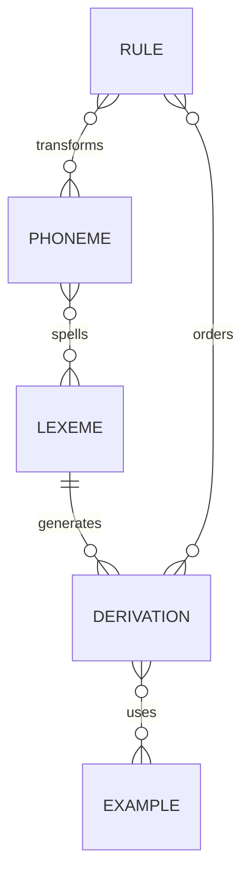

# 领域与本体设计

## 专业聚合

Evidence固定依据、Phoneme音位、Lexeme词条、Rule有限词形规则、Derivation命名派生、Example逐词例句、Note固定意见。根字段：evidence、phonemes、lexemes、rules、derivations、examples、notes、basis_refs。专业对象以WorkRef＋owner_plugin_id＋object_id确定身份，revision＋sha256固定内容。相同标题不代表同一对象。

词条以显式音位ID序列记录，音位正字唯一不强制、派生保留ID边界。规则只支持明确音位序列的前缀、后缀、替换；替换单轮从左至右非重叠执行，不执行正则或脚本、不重复直到稳定。每次最多30规则、256音位，空匹配拒绝；规则可限定词类，不满足时明确拒绝。命名派生固定词根与有序规则摘要，保存逐步音位及正字结果；改规则后旧派生待复核而保留。例句按明确词条/派生引用和逐词注释，不用字符数推断音节或假装语言学认证。

所有集合ID唯一、所有引用存在、集合有界、顺序在对应父级唯一。撤销先处理依赖，不能制造悬空引用；来源索引只追加，整本保存不能改变原索引意义。跨包引用只携带固定Owner、对象、修订与摘要，通过公开SDK回读，不导入对方私有结构。

## 权属

原始资料、作品身份与受管事务归Core；专业记录归本包；理解、创作与解释归作者选择的外部Agent；表达取舍与定稿归作者。借助欧卡姆原理复用通用事实，只增加本旅程需要的专业状态。
